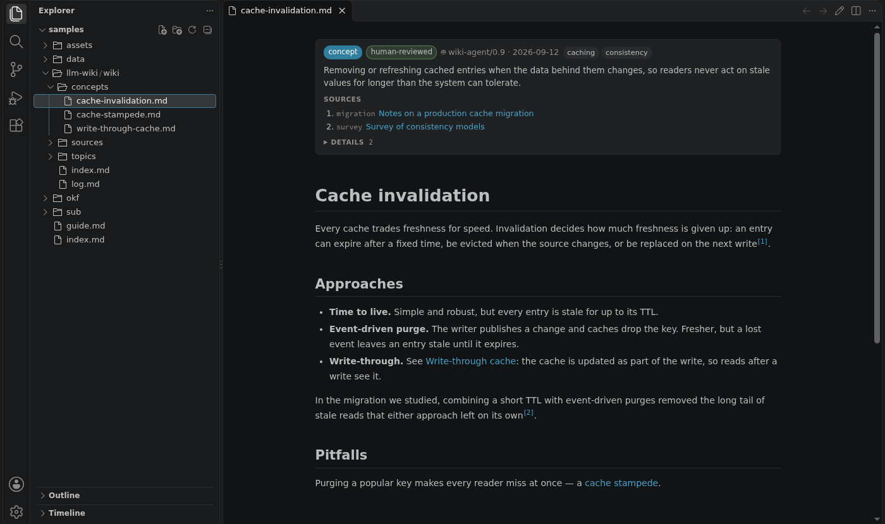
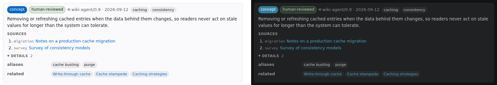
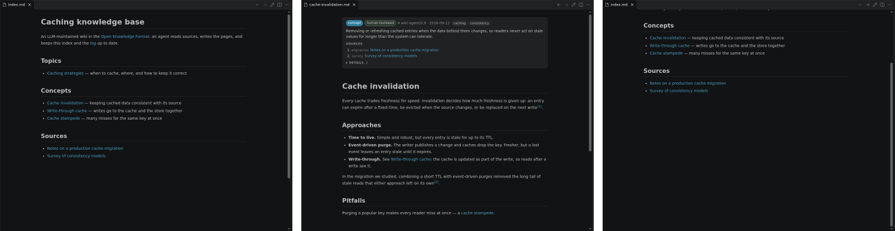
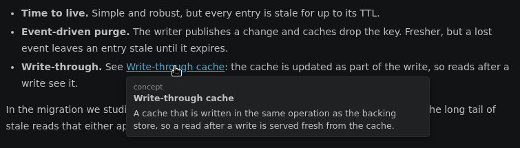

# KnowledgeWalk

**A reader for LLM-maintained Markdown wikis and [Open Knowledge Format][okf] (OKF)
knowledge bases.**

When a model writes and maintains your wiki, you mostly read it. KnowledgeWalk opens every
`.md` file as a rendered page, follows links in the same tab with Back and Forward, and
turns each page's YAML front matter — what it is, where it came from, who generated it and
who checked it — into a card you can take in at a glance.



## Why KnowledgeWalk

- **Built for LLM wikis.** Agent-maintained knowledge bases keep the facts that matter for
  trust in front matter: sources, status, generation and verification. KnowledgeWalk shows
  them, instead of hiding them or dumping raw YAML at the top of the page.
- **Speaks OKF v0.2.** Concept IDs, `sources` and `[^id]` citations, `generated` /
  `verified` trust tiers, `status` and `stale_after`, bundle roots — all understood with no
  configuration. Keys a wiki adds of its own are shown sensibly and can be styled per wiki.
- **Reads like a website.** Pages open as previews, links stay in the tab, every tab has
  its own history, and you come back to where you were.

## Features

### Front matter as a card



- **Badges** for the page's `type` and `status`, its **trust tier** — *unverified*,
  *machine-confirmed*, or *human-reviewed* once a `human:` actor appears in `verified` — and
  who generated it, and when.
- **Sources**, each linked and labelled with the linked page's own title. `[^id]` citations
  in the body become numbered links to them.
- **Banners** for deprecated pages, pages past their `stale_after`, and pages whose sources
  changed after they were generated.
- **References become links.** Concept IDs such as `concepts/cache-invalidation`, relative
  and root-relative paths in front matter link to the page they name. A reference that is
  ambiguous or broken is marked rather than guessed at.
- Everything else under a collapsible *Details*. The layout is configurable per wiki with a
  `.knowledgewalk.yaml` — see [the card reference](docs/front-matter-card.md).

### Browse like a website



- `.md` files open as a rendered page — from the Explorer, Quick Open, or a link anywhere.
- A link to another Markdown file opens **in the same tab**, which is renamed to match.
  Ctrl/Cmd-click or middle-click opens it in a background tab instead.
- **Back and Forward** per tab: the arrows in the tab's title bar, <kbd>Alt</kbd>+<kbd>←</kbd>
  / <kbd>Alt</kbd>+<kbd>→</kbd>, or the context menu. Back returns to the link you followed.
- **Hover a link** to see the linked page's title and description before you go there.

  

- **Edit in place.** Double-click a paragraph (or use *Open in Editor*) to switch to the
  source at that paragraph; *Open Preview* brings you back to the same place.

### Wikis

- `[[Note]]`, `[[Note|text]]`, `[[Note#Heading]]` and `![[image.png]]`, resolved across the
  whole wiki. A name with no page behind it is marked, not turned into a dead link.
- The **wiki root** comes from a `root:` key in front matter, a marker such as `.obsidian`,
  or the workspace folder; the **OKF bundle root** from the `index.md` that declares
  `okf_version`. See [wiki roots and path resolution](docs/wiki-roots.md).

### Rendering

GitHub-flavoured tables, task lists and footnotes; syntax highlighting; Mermaid diagrams;
KaTeX math; dates shown as written, without time-zone shifts. The page follows your colour
theme, <kbd>Ctrl</kbd>/<kbd>Cmd</kbd>+<kbd>F</kbd> finds in it, and it re-renders as the
file changes — including while an agent is still writing it.

## Getting started

1. Install KnowledgeWalk and reload the window.
2. Open any `.md` file. It opens as a page.
3. For a tour, clone the repository and open
   [`samples/llm-wiki/wiki/index.md`](samples/llm-wiki/wiki/index.md): a small
   LLM-maintained wiki in OKF.
4. To give your wiki's own keys a look of their own, put a `.knowledgewalk.yaml` at its
   root:

   ```yaml
   frontMatter:
     fields:
       priority: { as: badge, colors: { high: red, medium: orange, low: gray } }
       owner:    { as: text }
       related:  { as: links }
   ```

   [`docs/examples/`](docs/examples) has complete examples for a minimal OKF wiki, an
   Obsidian-style vault, architecture decision records and a research wiki. In
   `settings.json` and (with the YAML extension) in `.knowledgewalk.yaml`, keys and values
   are completed and checked as you type.

## Settings

| Setting | Default | |
| --- | --- | --- |
| `knowledgeWalk.frontMatter` | `auto` | `auto` (a card when the front matter has a `type`), `table` (always a card), `hide` or `source` (raw YAML). |
| `knowledgeWalk.frontMatterDisplay` | `{}` | Layout of the card; see [the card reference](docs/front-matter-card.md#configuring-the-card). A wiki's own `.knowledgewalk.yaml` is layered over it. |
| `knowledgeWalk.wikiRootKey` | `root` | The front matter key that names a document's wiki root. Change it if `root` already means something else in your documents. |
| `knowledgeWalk.knownFileExtensions` | `[]` | Extra extensions (`.fasta`, `.drawio`, …) that mark a front matter value as a file, so a broken one is flagged. |
| `knowledgeWalk.doubleClickToEdit` | `true` | Double-click the body to switch to the editor. Turn this off if it fights with selecting text. |
| `knowledgeWalk.mermaid.enabled` | `true` | Render ` ```mermaid ` blocks as diagrams. |
| `knowledgeWalk.math.enabled` | `true` | Render `$…$` and `$$…$$` with KaTeX. |
| `knowledgeWalk.allowRawHtml` | `true` | Allow raw HTML in Markdown. Output is sanitized either way. |
| `knowledgeWalk.wikiLinks` | `true` | Resolve `[[wiki links]]`. |
| `knowledgeWalk.wikiRootMarkers` | `[".obsidian"]` | Files or directories that mark a wiki root. |
| `knowledgeWalk.wikiLinkFallback` | `unique` | `unique` resolves a name outside the wiki when exactly one file matches; `none` keeps wikis hermetic. |
| `knowledgeWalk.linkify` | `urls` | `urls` (text with a scheme), `all` (also bare hostnames) or `off`. |
| `knowledgeWalk.retainHiddenPreviews` | `true` | Keep hidden previews loaded so returning to a tab is instant. Off trades memory for a re-render. |
| `knowledgeWalk.reclaimTextEditors` | `true` | Turn a Markdown file that landed in a plain text editor into a preview. Files opened with **Open in Editor** are left alone. |
| `knowledgeWalk.maxHistoryLength` | `50` | Entries kept per tab. |
| `knowledgeWalk.scrollOffset` | `8` | Breathing room above an element scrolled to the top. |

## Troubleshooting

### A .md file still opens as text

1. **Reload the window** (`Developer: Reload Window`). An extension installed into a
   running window is not picked up by tabs that are already open.
2. **Close the old tabs and open the file again.** VS Code restores each tab as whatever
   editor it was last time, so tabs from before the install come back as text editors.
   With `knowledgeWalk.reclaimTextEditors` on they are converted automatically, but only
   once the extension has been activated in that window.
3. **Check `workbench.editorAssociations`** in your user settings. An entry such as
   `"*.md": "default"` overrides the preview. Remove it, or leave the reclaim setting on.

### Something else looks wrong

*KnowledgeWalk: Show Log* opens a log of activation, every navigation, render failures,
references that could not be resolved, and errors raised inside the preview page.

## Learn more

- [The metadata card](docs/front-matter-card.md) — what is shown, and how to configure it
- [Wiki roots and path resolution](docs/wiki-roots.md)
- [How KnowledgeWalk works](docs/architecture.md) — design notes
- [Installing a local build into a dev container](docs/devcontainer.md)
- [Contributing](CONTRIBUTING.md) · [Changelog](CHANGELOG.md) · [MIT License](LICENSE)

[okf]: https://github.com/GoogleCloudPlatform/open-knowledge-format
