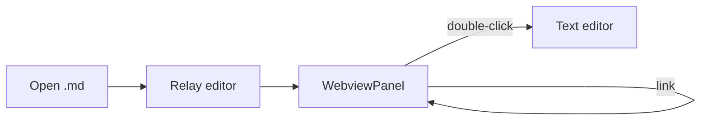

# KnowledgeWalk samples: index

This folder is for trying KnowledgeWalk's behaviour by hand.


## Kinds of link

| Link | Expected behaviour |
| --- | --- |
| [Guide](guide.md) | Navigates in the same tab; the tab is renamed `guide.md` |
| [A page in a subfolder](sub/deep.md) | The relative path resolves and opens in the same tab |
| [The guide's Settings section](guide.md#settings) | Opens in the same tab with that heading at the top |
| [Further down this page](#scrolling) | Moves within the page and is added to the history |
| [A CSV file](data/table.csv) | Opens in a normal text editor (not a preview) |
| [External site](https://code.visualstudio.com/api) | Opens in the default browser |

## An OKF wiki

[The sample handbook](okf/handbook/wiki/index.md) is a small OKF v0.2 bundle for checking front matter (the card, sources,
citations, verification, deprecated and stale banners).

## wiki link

Obsidian-style links work too.

- [[guide]] — resolved by name across the whole workspace
- [[deep|the subfolder page]] — the text after `|` is shown
- [[guide#settings]] — a heading can be named
- [[No such page]] — a name with no file behind it is marked, not linked

## Things that are not links

Run `build.py`, then check setup.cfg. These are only mentioned
in passing, so they are not links. https://code.visualstudio.com is clearly a URL, so it is
one.

## Math

Inline $E = mc^2$, and a display equation:

$$
\int_{-\infty}^{\infty} e^{-x^2}\,dx = \sqrt{\pi}
$$

## Diagram



## Code

```ts
export function classifyLink(href: string, base: Uri): ClassifiedLink {
  if (href.startsWith('#')) {
    return { kind: 'anchor', target: base, fragment: href.slice(1) };
  }
  return { kind: 'markdown', target: resolveRelative(base, href) };
}
```

## Checklist

- [x] The preview opens by default
- [x] Links navigate in the same tab
- [ ] Back returns to the link

## Scrolling

A long body follows. Scroll down to **the link at the very bottom**, follow it to
`guide.md`, then press Back (← / Alt+←),
and the link you clicked should be back at the top of the view.

1. Filler paragraph. It makes the preview long enough to check that Back restores the scroll position correctly.
2. Filler paragraph. It makes the preview long enough to check that Back restores the scroll position correctly.
3. Filler paragraph. It makes the preview long enough to check that Back restores the scroll position correctly.
4. Filler paragraph. It makes the preview long enough to check that Back restores the scroll position correctly.
5. Filler paragraph. It makes the preview long enough to check that Back restores the scroll position correctly.
6. Filler paragraph. It makes the preview long enough to check that Back restores the scroll position correctly.
7. Filler paragraph. It makes the preview long enough to check that Back restores the scroll position correctly.
8. Filler paragraph. It makes the preview long enough to check that Back restores the scroll position correctly.
9. Filler paragraph. It makes the preview long enough to check that Back restores the scroll position correctly.
10. Filler paragraph. It makes the preview long enough to check that Back restores the scroll position correctly.
11. Filler paragraph. It makes the preview long enough to check that Back restores the scroll position correctly.
12. Filler paragraph. It makes the preview long enough to check that Back restores the scroll position correctly.
13. Filler paragraph. It makes the preview long enough to check that Back restores the scroll position correctly.
14. Filler paragraph. It makes the preview long enough to check that Back restores the scroll position correctly.
15. Filler paragraph. It makes the preview long enough to check that Back restores the scroll position correctly.
16. Filler paragraph. It makes the preview long enough to check that Back restores the scroll position correctly.
17. Filler paragraph. It makes the preview long enough to check that Back restores the scroll position correctly.
18. Filler paragraph. It makes the preview long enough to check that Back restores the scroll position correctly.
19. Filler paragraph. It makes the preview long enough to check that Back restores the scroll position correctly.
20. Filler paragraph. It makes the preview long enough to check that Back restores the scroll position correctly.
21. Filler paragraph. It makes the preview long enough to check that Back restores the scroll position correctly.
22. Filler paragraph. It makes the preview long enough to check that Back restores the scroll position correctly.
23. Filler paragraph. It makes the preview long enough to check that Back restores the scroll position correctly.
24. Filler paragraph. It makes the preview long enough to check that Back restores the scroll position correctly.
25. Filler paragraph. It makes the preview long enough to check that Back restores the scroll position correctly.
26. Filler paragraph. It makes the preview long enough to check that Back restores the scroll position correctly.
27. Filler paragraph. It makes the preview long enough to check that Back restores the scroll position correctly.
28. Filler paragraph. It makes the preview long enough to check that Back restores the scroll position correctly.
29. Filler paragraph. It makes the preview long enough to check that Back restores the scroll position correctly.
30. Filler paragraph. It makes the preview long enough to check that Back restores the scroll position correctly.
31. Filler paragraph. It makes the preview long enough to check that Back restores the scroll position correctly.
32. Filler paragraph. It makes the preview long enough to check that Back restores the scroll position correctly.
33. Filler paragraph. It makes the preview long enough to check that Back restores the scroll position correctly.
34. Filler paragraph. It makes the preview long enough to check that Back restores the scroll position correctly.
35. Filler paragraph. It makes the preview long enough to check that Back restores the scroll position correctly.
36. Filler paragraph. It makes the preview long enough to check that Back restores the scroll position correctly.
37. Filler paragraph. It makes the preview long enough to check that Back restores the scroll position correctly.
38. Filler paragraph. It makes the preview long enough to check that Back restores the scroll position correctly.
39. Filler paragraph. It makes the preview long enough to check that Back restores the scroll position correctly.
40. Filler paragraph. It makes the preview long enough to check that Back restores the scroll position correctly.

### The link at the end of the page

This is the bottom. → [Open the guide (this link comes back to the top on Back)](guide.md)
