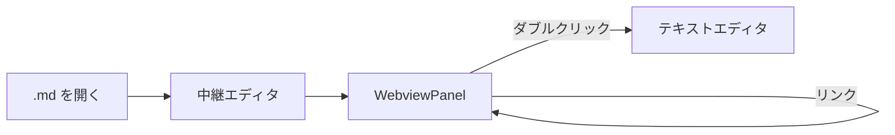

# mdExplorer サンプル: 目次

このフォルダは mdExplorer の 3 つの要件を手で確かめるための資料です。


## リンクの種類

| リンク | 期待される動作 |
| --- | --- |
| [ガイド](guide.md) | 同じタブでプレビュー遷移。タブ名が `guide.md` に変わる |
| [深い階層のページ](sub/deep.md) | 相対パスが解決され、同じタブで開く |
| [ガイドの「設定」節](guide.md#設定) | 同じタブで開き、その見出しが最上部に来る |
| [このページの下の方](#スクロールの確認) | 同じページ内を移動し、履歴にも積まれる |
| [CSV ファイル](data/table.csv) | 通常のテキストエディタで開く（プレビューにはならない） |
| [外部サイト](https://code.visualstudio.com/api) | 既定のブラウザで開く |

## OKF の wiki

[サンプル研究 Wiki](okf/research/wiki/index.md) は OKF v0.2 の front matter（カード表示、出典、
脚注、検証状態、廃止・期限切れの帯）を確かめるための小さなバンドルです。

## wiki link

Obsidian 形式のリンクも使えます。

- [[guide]] — 名前だけでワークスペース全体から解決します
- [[deep|サブフォルダのページ]] — `|` の後ろが表示名になります
- [[guide#設定]] — 見出しを指定できます
- [[存在しないページ]] — 該当ファイルが無いものはリンクにせず印だけ付けます

## リンクにならないもの

`vcf2phylip.py` を実行してから setup.cfg を確認します。これらは文中で言及しているだけ
なので、リンクになりません。https://code.visualstudio.com は URL と分かるのでリンクに
なります。

## 数式

インラインの $E = mc^2$ と、独立した式:

$$
\int_{-\infty}^{\infty} e^{-x^2}\,dx = \sqrt{\pi}
$$

## 図



## コード

```ts
export function classifyLink(href: string, base: Uri): ClassifiedLink {
  if (href.startsWith('#')) {
    return { kind: 'anchor', target: base, fragment: href.slice(1) };
  }
  return { kind: 'markdown', target: resolveRelative(base, href) };
}
```

## チェックリスト

- [x] プレビューが既定で開く
- [x] リンクが同じタブで遷移する
- [ ] 戻るとリンク位置に復帰する

## スクロールの確認

ここから下に長い本文が続きます。**一番下のリンク**までスクロールしてから
`guide.md` へ移動し、戻る（← / Alt+←）を押すと、
クリックしたリンクが画面の最上部に来るはずです。

1. 埋め草の段落です。プレビューを十分に長くして、戻ったときのスクロール位置が正しく復元されることを確認できるようにしています。
2. 埋め草の段落です。プレビューを十分に長くして、戻ったときのスクロール位置が正しく復元されることを確認できるようにしています。
3. 埋め草の段落です。プレビューを十分に長くして、戻ったときのスクロール位置が正しく復元されることを確認できるようにしています。
4. 埋め草の段落です。プレビューを十分に長くして、戻ったときのスクロール位置が正しく復元されることを確認できるようにしています。
5. 埋め草の段落です。プレビューを十分に長くして、戻ったときのスクロール位置が正しく復元されることを確認できるようにしています。
6. 埋め草の段落です。プレビューを十分に長くして、戻ったときのスクロール位置が正しく復元されることを確認できるようにしています。
7. 埋め草の段落です。プレビューを十分に長くして、戻ったときのスクロール位置が正しく復元されることを確認できるようにしています。
8. 埋め草の段落です。プレビューを十分に長くして、戻ったときのスクロール位置が正しく復元されることを確認できるようにしています。
9. 埋め草の段落です。プレビューを十分に長くして、戻ったときのスクロール位置が正しく復元されることを確認できるようにしています。
10. 埋め草の段落です。プレビューを十分に長くして、戻ったときのスクロール位置が正しく復元されることを確認できるようにしています。
11. 埋め草の段落です。プレビューを十分に長くして、戻ったときのスクロール位置が正しく復元されることを確認できるようにしています。
12. 埋め草の段落です。プレビューを十分に長くして、戻ったときのスクロール位置が正しく復元されることを確認できるようにしています。
13. 埋め草の段落です。プレビューを十分に長くして、戻ったときのスクロール位置が正しく復元されることを確認できるようにしています。
14. 埋め草の段落です。プレビューを十分に長くして、戻ったときのスクロール位置が正しく復元されることを確認できるようにしています。
15. 埋め草の段落です。プレビューを十分に長くして、戻ったときのスクロール位置が正しく復元されることを確認できるようにしています。
16. 埋め草の段落です。プレビューを十分に長くして、戻ったときのスクロール位置が正しく復元されることを確認できるようにしています。
17. 埋め草の段落です。プレビューを十分に長くして、戻ったときのスクロール位置が正しく復元されることを確認できるようにしています。
18. 埋め草の段落です。プレビューを十分に長くして、戻ったときのスクロール位置が正しく復元されることを確認できるようにしています。
19. 埋め草の段落です。プレビューを十分に長くして、戻ったときのスクロール位置が正しく復元されることを確認できるようにしています。
20. 埋め草の段落です。プレビューを十分に長くして、戻ったときのスクロール位置が正しく復元されることを確認できるようにしています。
21. 埋め草の段落です。プレビューを十分に長くして、戻ったときのスクロール位置が正しく復元されることを確認できるようにしています。
22. 埋め草の段落です。プレビューを十分に長くして、戻ったときのスクロール位置が正しく復元されることを確認できるようにしています。
23. 埋め草の段落です。プレビューを十分に長くして、戻ったときのスクロール位置が正しく復元されることを確認できるようにしています。
24. 埋め草の段落です。プレビューを十分に長くして、戻ったときのスクロール位置が正しく復元されることを確認できるようにしています。
25. 埋め草の段落です。プレビューを十分に長くして、戻ったときのスクロール位置が正しく復元されることを確認できるようにしています。
26. 埋め草の段落です。プレビューを十分に長くして、戻ったときのスクロール位置が正しく復元されることを確認できるようにしています。
27. 埋め草の段落です。プレビューを十分に長くして、戻ったときのスクロール位置が正しく復元されることを確認できるようにしています。
28. 埋め草の段落です。プレビューを十分に長くして、戻ったときのスクロール位置が正しく復元されることを確認できるようにしています。
29. 埋め草の段落です。プレビューを十分に長くして、戻ったときのスクロール位置が正しく復元されることを確認できるようにしています。
30. 埋め草の段落です。プレビューを十分に長くして、戻ったときのスクロール位置が正しく復元されることを確認できるようにしています。
31. 埋め草の段落です。プレビューを十分に長くして、戻ったときのスクロール位置が正しく復元されることを確認できるようにしています。
32. 埋め草の段落です。プレビューを十分に長くして、戻ったときのスクロール位置が正しく復元されることを確認できるようにしています。
33. 埋め草の段落です。プレビューを十分に長くして、戻ったときのスクロール位置が正しく復元されることを確認できるようにしています。
34. 埋め草の段落です。プレビューを十分に長くして、戻ったときのスクロール位置が正しく復元されることを確認できるようにしています。
35. 埋め草の段落です。プレビューを十分に長くして、戻ったときのスクロール位置が正しく復元されることを確認できるようにしています。
36. 埋め草の段落です。プレビューを十分に長くして、戻ったときのスクロール位置が正しく復元されることを確認できるようにしています。
37. 埋め草の段落です。プレビューを十分に長くして、戻ったときのスクロール位置が正しく復元されることを確認できるようにしています。
38. 埋め草の段落です。プレビューを十分に長くして、戻ったときのスクロール位置が正しく復元されることを確認できるようにしています。
39. 埋め草の段落です。プレビューを十分に長くして、戻ったときのスクロール位置が正しく復元されることを確認できるようにしています。
40. 埋め草の段落です。プレビューを十分に長くして、戻ったときのスクロール位置が正しく復元されることを確認できるようにしています。

### ページ末尾のリンク

ここが最下部です。→ [ガイドを開く（このリンクが戻ったときに最上部に来る）](guide.md)
